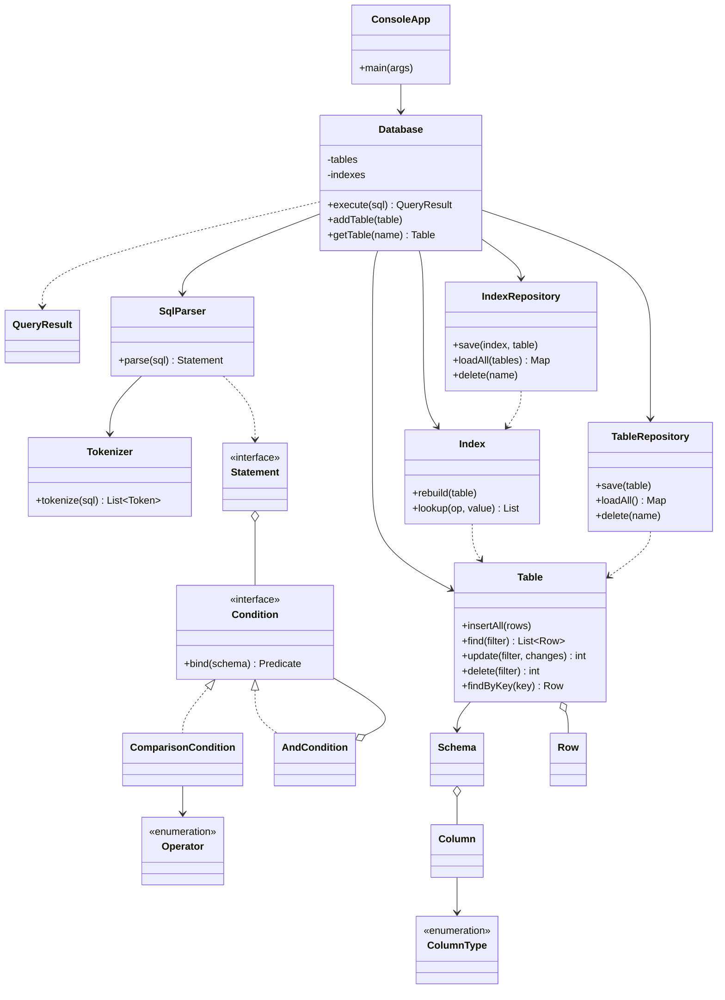
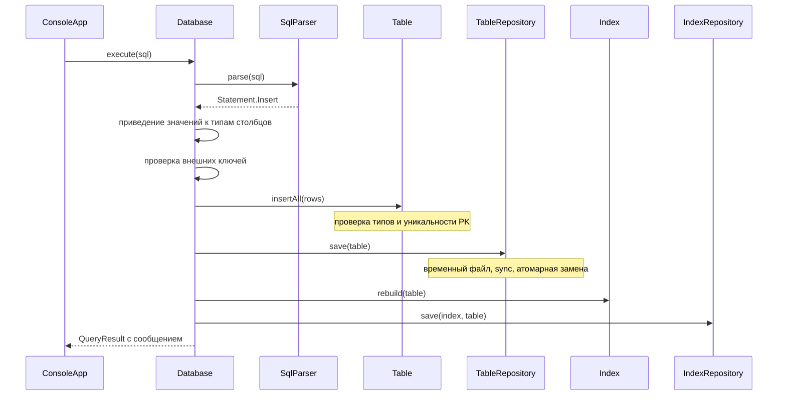
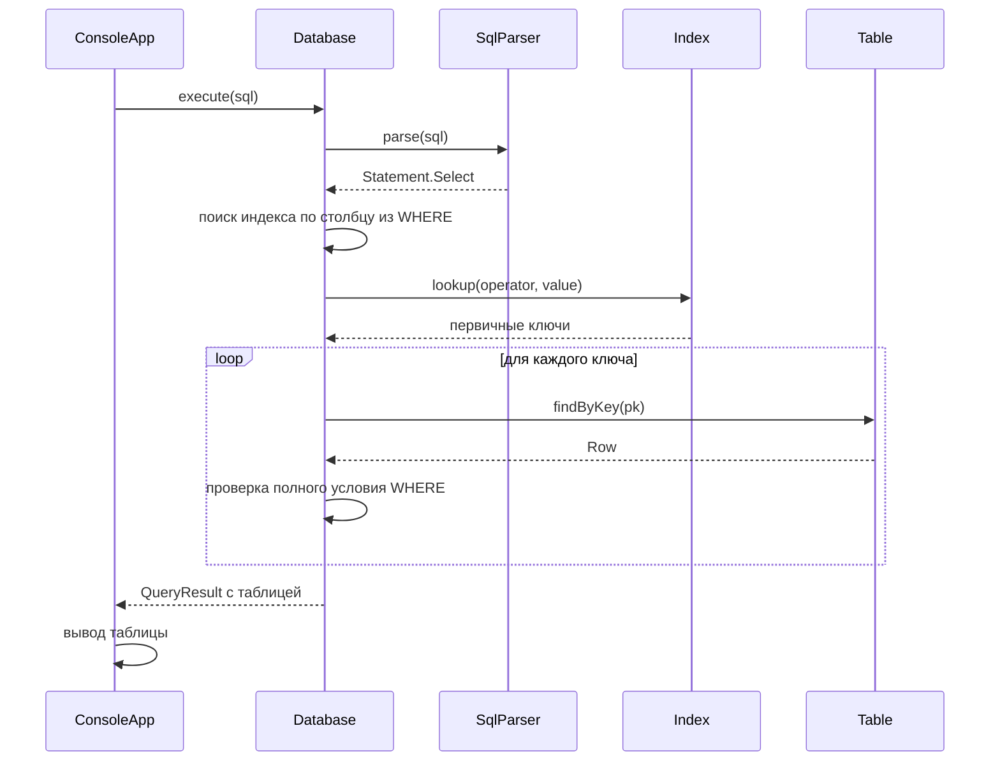

# Mini DBMS (UFC)
Выполнил: Петров Артём Олегович, 25КНТ6

Упрощённая СУБД на Java. Предметная область: бойцы UFC. Данные хранятся в бинарных файлах на диске, запросы вводятся на SQL-подобном языке через консоль. Поддерживаются связанные таблицы (внешние ключи) и индексы.


## Возможности

- Типы данных: `INT`, `DOUBLE`, `STRING`, `DATE`, `BOOLEAN`.
- Команды: `INSERT INTO`, `SELECT`, `UPDATE`, `DELETE`, `CREATE TABLE`, `DROP TABLE`, `CREATE INDEX`, `DROP INDEX`.
- Условие `WHERE`: сравнения `=`, `!=`, `<>`, `<`, `>`, `<=`, `>=`, соединённые через `AND`.
- Первичный ключ с проверкой уникальности (в том числе при вставке нескольких записей за один запрос).
- Внешние ключи: `REFERENCES`, проверка при вставке, обновлении, удалении и `DROP TABLE`.
- Индексы на диске, восстанавливаются при запуске и используются в `SELECT`.
- Надёжная запись: временный файл, `sync`, атомарная замена.

## Предметная область

Две связанные таблицы создаются автоматически при первом запуске (см. `DemoData`):

| divisions | тип |
|---|---|
| id (PK) | INT |
| name | STRING |
| max_weight | DOUBLE |

| fighters | тип |
|---|---|
| id (PK) | INT |
| name | STRING |
| weight | DOUBLE |
| birth_date | DATE |
| is_champion | BOOLEAN |
| division_id (FK, ссылается на divisions.id) | INT |

## Архитектура

### Структура пакетов

```
src/main/java/ufcdb/
  model/    ColumnType, Column, Schema, Row, Table, ValueCoercer, DbException
  storage/  TableRepository, IndexRepository
  query/    Tokenizer, Token, TokenType, SqlParser, Statement,
            Condition, ComparisonCondition, AndCondition, Operator
  index/    Index
  engine/   Database, QueryResult, DemoData
  ui/       ConsoleApp
  bench/    Benchmark
```

Слои: интерфейс (`ui`) вызывает ядро (`engine`), ядро использует парсер (`query`), модель (`model`), индексы (`index`) и хранилище (`storage`). Модель ничего не знает о хранилище и парсере.

### Применённые паттерны

- **Repository**: `TableRepository` и `IndexRepository` скрывают формат файлов, остальной код работает с объектами `Table` и `Index`.
- **Command**: каждый запрос разбирается в объект `Statement`, выполняет его `Database`.
- **Interpreter / рекурсивный спуск**: `SqlParser` разбирает токены без внешних библиотек.
- **Strategy**: условие `WHERE` представлено интерфейсом `Condition` с реализациями `ComparisonCondition` и `AndCondition`. Метод `bind(schema)` превращает условие в `Predicate<Row>`.
- **Iterator**: обход записей таблицы и значений индекса через итераторы коллекций Java.

### Диаграмма классов



Вложенные классы `Statement`: `Insert`, `Select`, `Update`, `Delete`, `CreateTable`, `DropTable`, `CreateIndex`, `DropIndex`.

### Диаграмма последовательности: INSERT



### Диаграмма последовательности: SELECT с индексом



Если индекса по столбцу нет или оператор `!=`, `Database` перебирает всю таблицу методом `Table.find`.

## Хранение данных

Все файлы лежат в папке `data/`.

**Таблица** (`<имя>.tbl`, бинарный формат через `DataOutputStream`):
сигнатура формата, имя таблицы, число столбцов, для каждого столбца имя, тип, признак PK, признак внешнего ключа (и таблица со столбцом, на которые он ссылается), затем число записей и сами записи. Перед каждым значением записан флаг NULL.

**Индекс** (`<имя>.idx`): сигнатура, имя индекса, таблица, столбец, число различных значений, затем для каждого значения список первичных ключей записей.

**Надёжность при сбоях:**
1. Данные пишутся во временный файл `*.tmp`.
2. Вызывается `sync`: данные физически сбрасываются на диск.
3. Временный файл атомарно заменяет основной (`Files.move` с `ATOMIC_MOVE`).
4. При запуске остатки `*.tmp` удаляются. Если программа упала посреди записи, остаётся прежняя целая версия файла.
5. При запуске число записей в индексе сверяется с таблицей, при расхождении индекс перестраивается. Нечитаемый файл индекса удаляется.

## Индексы

Индекс хранится в памяти как `TreeMap`: значение столбца, затем список первичных ключей. Поэтому он ускоряет и точное совпадение (`=`), и диапазоны (`<`, `<=`, `>`, `>=`). Оператор `!=` индекс не использует. Если в `WHERE` несколько условий, индекс сужает выборку по одному из них, остальные условия проверяются для найденных записей. Значения `NULL` не индексируются. Когда `SELECT` использует индекс, консоль пишет `Использован индекс: <имя>`.

## Тестирование производительности

Класс `ufcdb.bench.Benchmark` создаёт таблицу случайных бойцов (фиксированный seed) во временной папке и измеряет среднее время одного `SELECT` вместе с разбором SQL.

**Условия замера:** OpenJDK 25.0.4.1 LTS, 16 ГБ ОЗУ. Точечных запросов 100, диапазонных 50, перед измерением 20 запросов для прогрева JVM. Диапазонный запрос `weight > 149.9` возвращает около 0.1% таблицы. Перед выводом проверяется, что с индексом и без него найдено одинаковое число строк.

| Записей | Запрос | Без индекса, мс | С индексом, мс | Ускорение |
|---|---|---|---|---|
| 10000 | name = '...' (точечный) | 0.1149 | 0.0083 | 14x |
| 10000 | weight > 149.9 (диапазон) | 0.1059 | 0.0218 | 5x |
| 100000 | name = '...' (точечный) | 0.5947 | 0.0050 | 120x |
| 100000 | weight > 149.9 (диапазон) | 0.4775 | 0.0265 | 18x |
| 300000 | name = '...' (точечный) | 1.6914 | 0.0041 | 410x |
| 300000 | weight > 149.9 (диапазон) | 1.4577 | 0.0289 | 50x |

Время построения двух индексов (по `name` и `weight`): 25 мс для 10 000 записей, 148 мс для 100 000, 424 мс для 300 000.

**Выводы по результатам:**
- Без индекса время растёт линейно с размером таблицы (полный перебор): в 30 раз больше записей означает примерно в 15 раз больше времени (часть времени уходит на разбор SQL и вывод).
- С индексом точечный запрос почти не зависит от размера таблицы (поиск по дереву за O(log n)), поэтому ускорение растёт: 14x, 120x, 410x.
- У диапазонного запроса ускорение меньше: нужно собрать все подходящие ключи и затем найти каждую запись по ключу. Но оно тоже растёт с размером таблицы (5x, 18x, 50x).
- Результаты зависят от компьютера и состояния JVM, поэтому абсолютные числа при повторном запуске будут немного отличаться, а порядок величин сохраняется.

Запуск: `java -cp out ufcdb.bench.Benchmark`.

## Инструкция пользователя

Требуется JDK 8 или новее. Код использует только возможности Java 8, проверен на OpenJDK 25.

```bash
git clone https://github.com/artem78-ai/Java_practice_2
cd Java_practice_2
javac -d out $(find src -name "*.java")
java -cp out ufcdb.ui.ConsoleApp
```

Запускать нужно из корня проекта: данные хранятся в папке `data`. При первом запуске создаются таблицы `divisions` и `fighters` с учебными данными. Чтобы вернуть исходные данные, удалите файлы `data/*.tbl` и `data/*.idx`.

Каждый запрос заканчивается символом `;` и может занимать несколько строк. Служебные команды: `help` (справка), `tables` (список таблиц), `exit` (выход).

### Примеры команд

```sql
SELECT * FROM fighters;
SELECT name, weight FROM fighters WHERE weight > 70 AND is_champion = TRUE;
SELECT * FROM fighters WHERE birth_date > '1990-01-01';

INSERT INTO fighters VALUES (7, 'Alex Pereira', 93.0, '1987-07-07', FALSE, 7);
INSERT INTO fighters (id, name) VALUES (8, 'Test Fighter');

UPDATE fighters SET is_champion = TRUE WHERE id = 2;
DELETE FROM fighters WHERE name = 'Conor McGregor';

CREATE TABLE trainers (id INT PRIMARY KEY, name STRING, fighter_id INT REFERENCES fighters(id));
DROP TABLE trainers;

CREATE INDEX idx_fighters_name ON fighters (name);
DROP INDEX idx_fighters_name;
```

Примечания к синтаксису: строки пишутся в одинарных кавычках (кавычка внутри строки удваивается: `'O''Neil'`), даты в формате `ГГГГ-ММ-ДД`, булевы значения `TRUE` и `FALSE`. В `CREATE TABLE` нужен ровно один `PRIMARY KEY`; кроме `INT`, `DOUBLE`, `STRING`, `DATE`, `BOOLEAN` допускаются синонимы `INTEGER`, `FLOAT`, `VARCHAR`, `TEXT`, `BOOL`.

### Примеры ошибок

```
INSERT INTO fighters VALUES (1, 'Дубликат', 70.0, '1990-01-01', FALSE, 4);
Ошибка: Нарушение уникальности первичного ключа: 1

INSERT INTO fighters VALUES (9, 'Test', 70.0, '1990-01-01', FALSE, 99);
Ошибка: Нарушение внешнего ключа: в таблице divisions нет записи с id = 99

DELETE FROM divisions WHERE id = 4;
Ошибка: Нельзя изменить или удалить запись 4: на неё ссылается таблица fighters
```

## Ограничения

- После каждого изменения таблица целиком перезаписывается на диск, а индексы перестраиваются заново (O(n) на каждую операцию). Для учебного объёма данных это приемлемо, для больших нагрузок нужны инкрементальное обновление индексов и журнал изменений.
- Нет транзакций, `OR`, `JOIN`, `ORDER BY`, агрегатных функций и сравнения с `NULL`.
- Внешний ключ должен ссылаться на первичный ключ другой таблицы, ссылка на саму себя не поддерживается.
- Проверка индекса при запуске сравнивает число записей, а не их содержимое. Рассинхронизацию с тем же числом записей она не обнаружит.
- Индекс по одному столбцу, составных индексов нет.

## Выводы

В ходе работы реализована упрощённая СУБД с тремя слоями: модель данных, хранилище и обработка запросов. Разбор SQL-подобного языка выполнен вручную (токенизатор и рекурсивный парсер), а объекты-команды отделены от их выполнения, что упрощает добавление новых команд. Данные переживают перезапуск благодаря бинарной сериализации, а запись через временный файл с атомарной заменой защищает от повреждения при аварийном завершении. Тест производительности подтвердил эффект индексов: на таблице в 300 000 записей точечный запрос стал быстрее в 410 раз, диапазонный в 50 раз.

## Источники

1. Oracle. Java SE Documentation: `java.io.DataOutputStream`, `java.io.DataInputStream`. https://docs.oracle.com/en/java/javase/
2. Oracle. Java SE Documentation: `java.nio.file.Files`, `StandardCopyOption.ATOMIC_MOVE`.
3. Oracle. Java SE Documentation: `java.util.TreeMap`, `java.util.function.Predicate`, `java.time.LocalDate`.
4. Gamma E., Helm R., Johnson R., Vlissides J. Design Patterns: Elements of Reusable Object-Oriented Software. Addison-Wesley, 1994.
5. Fowler M. Patterns of Enterprise Application Architecture (паттерн Repository). Addison-Wesley, 2002.
6. Mermaid. Documentation: Class diagrams, Sequence diagrams. https://mermaid.js.org/
7. GitHub Docs. Creating diagrams (Mermaid). https://docs.github.com/
